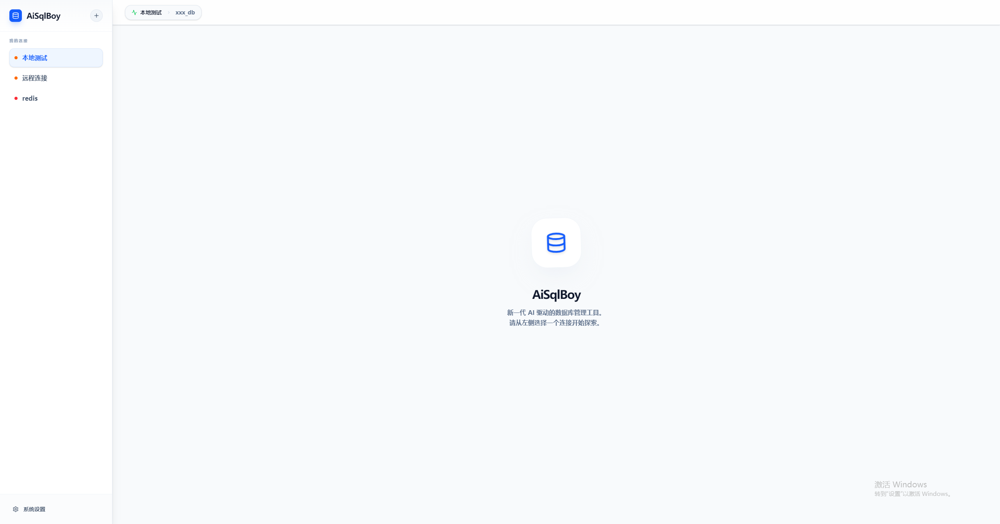

# AiSqlBoy

AiSqlBoy 是一款集成 AI 能力的现代化数据库管理工具，旨在通过人工智能简化 SQL 编写、调试和数据库管理流程。

## 🚀 功能特性

- **🤖 AI 智能辅助**：
  - **自然语言转 SQL**：通过对话直接生成复杂的 SQL 查询。
  - **智能修改**：选中 SQL 代码，通过 AI 指令快速优化或调整逻辑。
  - **上下文感知**：AI 自动读取当前数据库/表的 Schema（结构），拒绝幻觉，生成准确代码。
- **📊 多数据库支持**：支持 MySQL, PostgreSQL, SQLite 和 Redis。
- **🛠️ 控制台管理**：
  - 支持多标签控制台。
  - 控制台可针对特定表创建，自动关联表结构上下文。
  - 支持 SQL 自动补全和语法高亮。
- **📁 数据管理**：可视化浏览表数据、修改结构、管理索引。
- **🔄 自动更新**：内置自动更新机制，确保始终使用最新版本。
- **🔌 MCP 服务**：把本机已保存的数据库连接以 MCP 协议开放给 Cursor、Claude Code 等外部 AI 客户端，默认全只读，写权限需在设置中显式开启。
- **📦 自动化发布**：集成 GitHub Actions，支持通过 Git Tag 自动打包发布 Windows 安装包。

## 🛠️ 技术栈

- **Frontend**: React 19, Tailwind CSS 4, Framer Motion
- **Backend**: Electron 33, Node.js
- **Build Tool**: Vite 7
- **Database Drivers**: mysql2, pg, sqlite3, redis
- **AI Integration**: DeepSeek API (支持自定义 API Key)

## 📦 安装与开发

### 环境要求
- Node.js 20+
- npm 或 yarn

### 开发环境启动
```bash
# 安装依赖
npm install

# 启动开发服务器
npm run dev
```

### 打包发布
项目已配置 GitHub Actions 自动发布。手动打包命令：
```bash
# 生成安装包
npm run build

# 打包并尝试发布 (需要 GITHUB_TOKEN)
npm run publish
```

## 🔌 MCP 服务

AiSqlBoy 可以把本机已保存的连接以 MCP（Model Context Protocol）开放给外部 AI 客户端。

**启用**：设置 → MCP 服务 → 打开「启用本地 MCP 服务」。

**客户端配置**：设置页内直接点「复制」，粘贴到 MCP 客户端后重启客户端即可。内容形如：

```json
{
  "mcpServers": {
    "aisqlboy": {
      "command": "<AiSqlBoy 可执行文件路径>",
      "args": ["<resources>/mcp-server/index.mjs"],
      "env": { "ELECTRON_RUN_AS_NODE": "1" }
    }
  }
}
```

路径由应用自动填入，用应用自带的 Electron 运行时跑桥，客户端机器无需预装 Node。
**配置里没有密钥是正常的**：token 每次启动随机生成并存于本机端点文件，桥会自动读取。

**工作方式**：`aisqlboy-mcp` 是一个零依赖的 stdio 桥，只做协议转换；实际查询由运行中的 AiSqlBoy 主进程执行，
因此系统级加密的连接凭据、只读守卫、授权库白名单都照常生效，桥进程本身不接触任何密码。

**能力**：`list_connections`、`list_databases`、`list_tables`、`describe_table`、`run_query`、`explain_query`、`redis_command`。
写工具 `execute_sql` 仅在设置中开启「允许写操作」后才会注册。

详见 [packages/mcp-server/README.md](packages/mcp-server/README.md)。

## 📝 使用说明

1. **连接数据库**：在侧边栏点击“+”添加您的数据库连接。
2. **AI 配置**：在设置界面填入您的 DeepSeek API Key 即可开启 AI 辅助功能。
3. **创建控制台**：右键点击数据库或特定表，选择“新建查询控制台”。
4. **发布新版本**：
   - 提交代码后打上标签：`git tag v1.x.x`
   - 推送标签：`git push origin v1.x.x`
   - GitHub Actions 将自动处理后续打包。

## 📄 开源协议
ISC License
